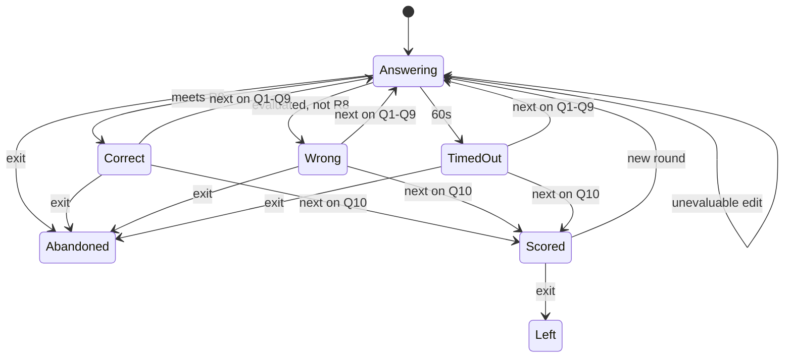
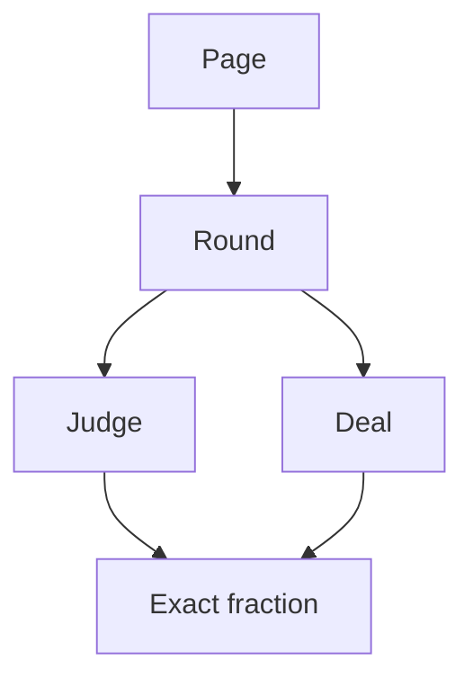

# 24 Point Game - Plan

## Goal Capsule

- **Objective:** 打开页面的人可以不借助实体扑克牌打完一轮 10 题的 24 点，并在结束时看到这一轮的分数。
- **Means:** 一个不依赖构建工具的静态页面，用精确分数计算判定和发牌（KTD1, KTD2）。
- **Product authority:** 本计划只定义这一轮单人游戏。登录、存档、排行榜、多人和难度不在本计划内。产品行为以 Product Contract 为准；实现方式以 Planning Contract 为准。
- **Stop conditions:** 出现与已确认产品规则冲突、或无法在精确分数下判定对错时停止，不改用近似小数。
- **Execution profile:** 先用节点测试钉住判定、发牌和一轮状态，再在浏览器里走完一局。
- **Who finishes:** 实现者完成 U1–U4，跑通验证，并让页面可以被打开来玩。
- **Open blockers:** 无。
- **Product Contract preservation:** Outstanding Questions 里的布局问题已由 KTD5 回答，其余产品条文未改范围。

---

## Product Contract

### Summary

玩家打开页面即开始一轮 10 题的 24 点。每题用四张有解的牌，在 60 秒内写出精确等于 24 的算式。10 题结束后看到总分。

### Problem Frame

24 点可以用一副扑克牌来玩。牌不在手边时，这一局就没法开始。要在电脑上玩，发牌、计时、判断对错和给出一种解法都得由页面完成。

### Key Decisions

- **经典四则判定。** (session-settled: user-directed — chosen over extra operators and any expression that merely equals 24: only the four card values and arithmetic count.) Governs R8, R9, R10, R11.
- **算不出来的算式不消耗作答。** (session-settled: user-directed — chosen over counting every submit and over allowing edits only when the cards were misused: a typo does not end the question.) Governs R12, R13.
- **超时后仍可进入下一题。** (session-settled: user-directed — chosen over locking the question with no next, auto-submitting, and ending the session.) Governs R16.
- **倒计时期间不能看答案。** (session-settled: user-directed — chosen over peeking during the minute and over peeking and then still submitting.) Governs R17, R23.
- **A、J、Q、K 按 1、11、12、13 计，花色不计分。** (session-settled: user-directed — chosen over dropping face cards and over letting the player treat an ace as 1 or 14.) Governs R7.
- **每手牌都有解。** (session-settled: user-directed — chosen over dealing unsolvable hands and over a fixed puzzle list.) Governs R6.
- **答错记 0 分并继续本轮。** (session-settled: user-directed — chosen over requiring a reveal before next and over ending the round on the first miss: all 10 questions are dealt.) Governs R15, R18.
- **中途退出不记分。** (session-settled: user-directed — chosen over scoring a partial round and over blocking exit until the end.) Governs R21.
- **中间结果可以是分数。** (session-settled: user-directed — chosen over requiring every step to be an integer.) Governs R10.
- **打开页面就开局，退出不自动重开。** (session-settled: user-directed — chosen over a start screen and over treating exit as a new round.) Governs R1, R20, R21, R22, R24.
- **保留 60 秒和 10 题计分，不保存分数。** (session-settled: user-directed — chosen over a deal-and-judge toy and over storing scores on the computer.) Governs R1, R2, R4, R5, R20, R24.
- **普通运算优先级；刷新直接换新一轮。** (session-settled: user-approved — chosen over left-to-right evaluation and over asking before a refresh discards the round: both were named before confirmation.) Governs R1, R10.

### Actors

- A1. 玩家。任何一个打开页面的人。没有账号。
- A2. 游戏。发牌、计时、判断算式、在允许时给出一种解、结算这一轮。

### Requirements

**开局与一轮**

- R1. 打开或刷新页面即从第 1 题开始新的一轮，不登录，也不保留玩家或上一轮分数。
- R2. 每一轮有 10 题。
- R3. 做题时能看出当前是 10 题中的第几题。
- R4. 每题倒计时 60 秒，并显示剩余时间。
- R5. 一轮结束前不显示累计分数。

**发牌**

- R6. 每题从去掉大小王的 52 张牌中发出四张互不相同的牌，并且这手牌至少有一个按 R8、R9、R10 判定为正确的算式。
- R7. 点数为 A=1、2–10 按面值、J=11、Q=12、K=13；花色显示出来，但不改变点数。

**判定**

- R8. 正确的算式把四个点数各用恰好一次，并且结果精确等于 24。
- R9. 只允许加、减、乘、除和括号；乘除可写成 `*` `/` 或 `×` `÷`；负号只表示相反数，不算新的数字。
- R10. 先算括号，再算乘除，再算加减；中间结果可以是分数。
- R11. 每个数字字面量都必须是这四张牌的点数之一，不能把数字拼成新的数，也不能写小数字面量。
- R12. 无法求出数值的算式不消耗作答，倒计时结束前可以继续修改。
- R13. 第一个能算出结果的算式消耗作答，并锁定输入。

**一题的结局**

- R14. 答对得 10 分，停止计时，让玩家知道答对了，并提供「下一题」和「退出」。
- R15. 答错得 0 分，停止计时，让玩家知道答错了，并提供「展示答案」「下一题」和「退出」。
- R16. 在交出能算出结果的算式之前时间到，得 0 分，锁定输入，让玩家知道已超时，并提供「展示答案」「下一题」和「退出」。
- R17. 「展示答案」只在 R15 或 R16 之后可用，并给出当前这四张牌的一种符合 R8 的算式。
- R18. 第 1 至第 9 题点「下一题」会发新牌，并按 R4 重新倒计时。
- R19. 第 10 题只有点了「下一题」才结束本轮。
- R23. 作答尚未锁定时，玩家可以提交和退出。

**一轮的结局**

- R20. 本轮结束后显示 10 题得分之和，并提供「开始下一轮」和「退出」。
- R21. 本轮结束前退出则不显示分数，撤掉继续本轮的操作，不再发牌；已经发出的牌可以留在页面上。
- R22. 在分数页退出则把分数留在页面上，撤掉「开始下一轮」，并且不再发牌。
- R24. 「开始下一轮」清掉分数，并从第 1 题开始新的一轮。

### Key Flows



- F1. 打开页面
  - **Trigger:** A1 打开或刷新页面。
  - **Actors:** A1, A2
  - **Steps:** 按 R1 开始新的一轮。按 R6、R7 发第 1 题。按 R3、R4 显示题号和倒计时。
  - **Outcome:** 玩家看到第 1 题，累计分数不可见。
  - **Covered by:** R1, R2, R3, R4, R5, R6, R7
- F2. 提交算式
  - **Trigger:** A1 在倒计时未结束时提交算式。
  - **Actors:** A1, A2
  - **Steps:** 无法求出数值时留在作答中，按 R12 允许修改。能求出数值时按 R13 锁定。符合 R8 则进入答对，否则进入答错。
  - **Outcome:** 答对走 R14。答错走 R15。
  - **Covered by:** R8, R9, R10, R11, R12, R13, R14, R15
- F3. 超时
  - **Trigger:** R4 的倒计时走完，且还没有能求出数值的提交。
  - **Actors:** A2
  - **Steps:** 按 R16 锁定本题。
  - **Outcome:** 本题 0 分，可以看一种解或进入下一题。
  - **Covered by:** R16, R17
- F4. 下一题与结算
  - **Trigger:** A1 在答对、答错或超时后点「下一题」。
  - **Actors:** A1, A2
  - **Steps:** 第 1 至第 9 题按 R18 发新牌。第 10 题按 R19、R20 结束本轮并显示得分之和。
  - **Outcome:** 要么进入下一题，要么看到本轮总分。
  - **Covered by:** R18, R19, R20
- F5. 再来一轮
  - **Trigger:** A1 在分数页点「开始下一轮」。
  - **Actors:** A1, A2
  - **Steps:** 按 R24 从第 1 题重新发牌。
  - **Outcome:** 新的一轮开始，上一轮分数不再显示。
  - **Covered by:** R24
- F6. 退出
  - **Trigger:** A1 点「退出」。
  - **Actors:** A1, A2
  - **Steps:** 作答中按 R23 可以退出。本轮尚未结束时按 R21。已在分数页时按 R22。
  - **Outcome:** 页面不再进入新的一题。
  - **Covered by:** R21, R22, R23

### Acceptance Examples

- AE1. 分数中间结果判对
  - **Covers R8, R9, R10, R14, R17.**
  - **Given:** 四张牌的点数是 6、1、3、4。
  - **When:** 玩家提交 `6÷(1−3÷4)`。
  - **Then:** 判为答对，得 10 分，不提供「展示答案」。
- AE2. 没有把四个点数各用一次
  - **Covers R8, R13, R15.**
  - **Given:** 四张牌的点数是 8、3、3、1。
  - **When:** 玩家提交 `8×3`。
  - **Then:** 算式能算出结果，输入锁定，本题 0 分，并提供「下一题」。
- AE3. 括号不配对可以再改
  - **Covers R12.**
  - **Given:** 倒计时仍在走。
  - **When:** 玩家提交 `(8+3`。
  - **Then:** 不锁定输入，玩家可以改完再交。
- AE4. 除以零可以再改
  - **Covers R12.**
  - **Given:** 倒计时仍在走，四张牌的点数是 8、3、3、1。
  - **When:** 玩家提交 `8÷(3−3)`。
  - **Then:** 不锁定输入，本题尚未记分。
- AE5. 两个相同点数都要用到
  - **Covers R7, R8, R11.**
  - **Given:** 四张牌的点数是 8、8、3、3。
  - **When:** 玩家提交 `8÷(3−8÷3)`。
  - **Then:** 判为答对。
- AE6. J 按 11 计
  - **Covers R7, R8.**
  - **Given:** 其中一张牌是 J。
  - **When:** 玩家把这张牌写成 11，并与其余三张各用一次，结果精确等于 24。
  - **Then:** 判为答对。
- AE7. 倒计时期间没有答案
  - **Covers R17, R23.**
  - **Given:** 本题仍在作答，输入尚未锁定。
  - **When:** 玩家查看可用操作。
  - **Then:** 没有「展示答案」。
- AE8. 答错不必看答案也能继续
  - **Covers R15, R17, R18.**
  - **Given:** 第 3 题的算式已算出结果，且不符合 R8。
  - **When:** 玩家不点「展示答案」，直接点「下一题」。
  - **Then:** 本题 0 分，进入第 4 题，倒计时重新从 60 秒开始。
- AE9. 超时记 0 分并可看一种解
  - **Covers R16, R17.**
  - **Given:** 60 秒走完，玩家没有提交过能算出结果的算式。
  - **When:** 玩家点「展示答案」。
  - **Then:** 本题 0 分，页面给出一种符合 R8 的算式，并且「下一题」仍可用。
- AE10. 第 10 题点下一题才出分
  - **Covers R5, R19, R20.**
  - **Given:** 第 10 题已经答对。
  - **When:** 玩家还没点「下一题」。
  - **Then:** 不显示本轮总分。点「下一题」后显示 10 题得分之和。
- AE11. 第 10 题改退出则没有分数
  - **Covers R19, R21.**
  - **Given:** 第 10 题已经有结局，玩家还没点「下一题」。
  - **When:** 玩家点「退出」。
  - **Then:** 不显示分数，也不再发牌。
- AE12. 中途退出
  - **Covers R21, R23.**
  - **Given:** 当前是第 4 题，倒计时仍在走。
  - **When:** 玩家点「退出」。
  - **Then:** 不显示分数，不能提交，不能进入下一题，不能开始新的一轮。
- AE13. 分数页再来一轮
  - **Covers R24.**
  - **Given:** 本轮总分已经显示。
  - **When:** 玩家点「开始下一轮」。
  - **Then:** 分数清掉，从第 1 题重新开始。
- AE14. 刷新丢掉进行中的一轮
  - **Covers R1.**
  - **Given:** 第 6 题正在倒计时。
  - **When:** 玩家刷新页面。
  - **Then:** 从第 1 题开始新的一轮，上一轮没有分数可看。
- AE15. 分数页退出
  - **Covers R22.**
  - **Given:** 本轮总分已经显示。
  - **When:** 玩家点「退出」。
  - **Then:** 分数留在页面上，且该页不再提供「开始下一轮」。

### Scope Boundaries

**Deferred for later**

- 登录、区分玩家、把分数留到下次打开。
- 排行榜、多人、难度档位。
- 完整答案以外的提示。

**Outside this product's identity**

- 教学课或逐步推导。玩家要自己写出算式。
- 开局前先浏览题库或解法。答案只在答错或超时之后出现。

### Dependencies / Assumptions

- 空白字符不参与计算。
- 「精确等于 24」指数学上相等。接近 24 的近似小数不算对。
- 同一轮里可以再次发到相同的点数组合。
- 有多种解时，R17 给出任意一种即可。

### Outstanding Questions

布局问题已在 KTD5 决定。没有还要在实现前回答的产品问题。

---

## Planning Contract

仓库里还没有应用代码。实现做成一组静态文件，用精确分数完成判定和发牌，用内存里的状态机走完一轮。

### Key Technical Decisions

- KTD1. 用无构建步骤的静态页面，脚本采用浏览器可加载的模块。不引入框架或打包器。页面通过本地静态服务打开，不把 `file://` 当作支持路径。
- KTD2. 用既约分数表示每一个中间结果和最终结果。除以零和无法解析的算式都算「无法求出数值」，不产生近似小数。落实 R8, R10, R12.
- KTD3. 发牌和「展示答案」共用同一次穷举：四种点数的二元运算树能得出 24 才发这手牌，并保留其中一棵树对应的算式。展示用的算式把每一步都加上括号，避免读者靠优先级猜。落实 R6, R17.
- KTD4. 判定、发牌和一轮状态用 Node 自带测试覆盖。页面行为在浏览器里按 Key Flows 走一遍。纯逻辑不放进页面脚本里才测。
- KTD5. 单列牌桌：上方是四张牌、题号和剩余秒数，中间是算式输入和提交，下方只出现当前状态允许的操作。本轮结束后同一页换成总分，以及「开始下一轮」和「退出」。花色用四个花色符号画在牌面上。

### High-Level Technical Design

页面只负责显示和把点击交给一轮状态机。状态机调用判定和发牌，不直接改页面。



一轮的状态转移以 Product Contract 的图为准。这里只补实现边界：提交先交给判定；无法求值就留在作答；能求值才进入答对或答错。发牌在进入每一题时调用，无解就换四张，不把无解牌展示出来。

### Sequencing

U1 先钉住精确计算和判定。U2 在此之上发有解的牌并给出一种算式。U3 把题目、计时和分数收成纯状态机。U4 最后把状态画到页面上。

### Assumptions

- 刷新就是重新加载页面，因此自然满足 R1。
- 输入里的 `×` `÷` 和各种减号在判定前归一成 `*` `/` `-`。
- 全角括号不要求识别。
- 同一点数的四张牌靠花色区分，计算只用点数。

---

## Output Structure

```text
index.html
styles.css
src/exact.js
src/judge.js
src/deal.js
src/round.js
src/main.js
test/judge.test.js
test/deal.test.js
test/round.test.js
test/page.test.js
README.md
```

---

## Implementation Units

### U1. 精确判定

- **Goal:** 给定四张牌的点数和一个算式，判定它是无法求值、答错，还是精确等于 24。
- **Requirements:** R8, R9, R10, R11, R12, R13. Covers AE1, AE2, AE3, AE4, AE5, AE6.
- **Dependencies:** 无。
- **Files:** `src/exact.js`, `src/judge.js`, `test/judge.test.js`
- **Approach:** 分数用分子和分母的既约对表示，加减乘除都在这个对上完成。除以零返回无法求值。算式去掉空白并归一运算符后，按括号、乘除、加减解析。收集数字字面量，与四个点数按重数比较；能求值但重数不符或结果不是 24，都是答错。负号只作为相反数。
- **Execution note:** 先写会失败的判定测试，再实现解析和计算。
- **Patterns to follow:** 仓库没有现成代码可照。保持判定函数不碰页面。
- **Test scenarios:**
  - Covers AE1. 点数 6、1、3、4，提交 `6÷(1−3÷4)`，结果为答对。
  - Covers AE2. 点数 8、3、3、1，提交 `8×3`，结果为答错且算式能求值。
  - Covers AE3. 提交 `(8+3`，结果为无法求值。
  - Covers AE4. 点数 8、3、3、1，提交 `8÷(3−3)`，结果为无法求值。
  - Covers AE5. 点数 8、8、3、3，提交 `8÷(3−8÷3)`，结果为答对。
  - Covers AE6. 点数含 11 时，用 11 且其余三张各一次、结果为 24，判对；把该点数写成 10 且算式能求值，判错。
  - 空字符串无法求值。
  - `8 + 8 + 8` 在四张牌为 8、8、3、3 时判错，因为没用全四个点数。
  - `1+3*8` 在点数 1、3、8、1 时按先乘后加计算；若结果不是 24 则判错，且乘除优先于加减。
- **Verification:** `test/judge.test.js` 里的场景全部通过，且判定不使用浮点近似。

### U2. 有解发牌

- **Goal:** 发出四张互不相同、至少有一解的牌，并能给出一种正确算式。
- **Requirements:** R6, R7, R17. Covers AE5, AE6, AE9.
- **Dependencies:** U1
- **Files:** `src/deal.js`, `test/deal.test.js`
- **Approach:** 牌组是去掉大小王的 52 张，每张有点数和花色。抽四张不同的牌。用二元运算树穷举这四个点数；没有任何树得到 24 就重抽。找到解时保留一条把每步都加括号的算式，供展示答案使用。穷举有上界，不会无限重抽到无解牌组，因为 24 点存在有解的四元组。
- **Patterns to follow:** 展示用的算式必须能被 U1 判为答对。
- **Test scenarios:**
  - 连续发若干手，每手都是四张不同的牌，且展示算式被 U1 判为答对。
  - 点数 8、8、3、3 能找到解，展示算式使用两个 8 和两个 3。
  - J 的点数是 11，展示算式里出现 11 而不是字母 J。
  - 同一点数可以出现多次，但四张牌的花色组合不重复成同一张物理牌。
- **Verification:** `test/deal.test.js` 通过，且测试不依赖某一次随机抽到的特定花色。

### U3. 一轮状态

- **Goal:** 用纯状态表达 10 题、60 秒、得分，以及下一题、看答案、退出和再来一轮。
- **Requirements:** R1, R2, R3, R4, R5, R14, R15, R16, R18, R19, R20, R21, R22, R23, R24. Covers F1, F2, F3, F4, F5, F6, AE7, AE8, AE9, AE10, AE11, AE12, AE13, AE14, AE15.
- **Dependencies:** U1, U2
- **Files:** `src/round.js`, `test/round.test.js`
- **Approach:** 状态机不碰 DOM。时钟由调用方传入「现在的毫秒」，剩余时间从本题开始时刻计算。提交调用 U1：无法求值则保持作答；答对得 10 分并停表；答错得 0 分并停表。到时且尚未有能求值的提交则记 0 分。第 1 到第 9 题的下一题重新发牌并重开 60 秒。第 10 题点下一题后才出现总分。退出在本轮结束前不产生分数；在分数页退出后不再提供再来一轮。开始下一轮清分并从第 1 题开始。展示答案只在答错或超时后返回 U2 留下的算式。
- **Execution note:** 用固定的毫秒时刻驱动计时，不在测试里等待真实的 60 秒。
- **Patterns to follow:** 得分规则只引用 R14、R15、R16，不在状态机里另写一套分数。
- **Test scenarios:**
  - Covers AE7. 作答未锁定时，可用操作有提交和退出，没有展示答案。
  - Covers AE8. 第 3 题答错后不看答案，直接下一题，本题 0 分，进入第 4 题且倒计时回到 60 秒。
  - Covers AE9. 时间到之后得 0 分，展示答案返回一条会被判对的算式，下一题仍可用。
  - Covers AE10. 第 10 题答对但还没点下一题时没有总分；点了之后总分等于 10 题之和。
  - Covers AE11. 第 10 题已有结局但未点下一题时退出，没有总分。
  - Covers AE12. 第 4 题倒计时中退出后不能提交、不能下一题、不能开始新一轮，也没有分数。
  - Covers AE13. 总分出现后开始下一轮，分数清掉，回到第 1 题。
  - Covers AE14. 重新开始等同于新的一轮，不保留上一轮分数。
  - Covers AE15. 分数页退出后分数仍在，且不再提供开始下一轮。
  - 10 题全对时总分是 100。答错和超时不增加分数。
- **Verification:** `test/round.test.js` 通过，且测试不打开浏览器。

### U4. 页面

- **Goal:** 打开页面就能玩完一轮，屏幕上的操作和 U3 的状态一致。
- **Requirements:** R1, R3, R4, R5, R7, R23. Covers F1, F2, F3, F4, F5, F6.
- **Dependencies:** U3
- **Files:** `index.html`, `styles.css`, `src/main.js`, `test/page.test.js`, `README.md`
- **Approach:** 按 KTD5 排一列。题号、剩余秒数、四张牌的点数和花色始终在作答和结局页上。按钮只在 U3 声明可用时出现。本轮结束后换成总分页。脚本模块从 `src/main.js` 启动状态机，每秒根据当前时刻刷新剩余时间。`README.md` 说明用本地静态服务打开 `index.html`。
- **Patterns to follow:** 页面不重新实现判定和计分。
- **Test scenarios:**
  - `index.html` 引用样式和 `src/main.js`，并留有牌、题号、计时、算式、提交、下一题、展示答案、退出、开始下一轮、总分这些区域。
  - 浏览器：打开即第 1 题，看到四张牌、题号和倒计时。
  - 浏览器：提交一个无法求值的算式后仍可修改。
  - 浏览器：答对后出现下一题，不出现展示答案，累计分仍不可见。
  - 浏览器：答错后可以不看答案直接下一题。
  - 浏览器：超时后可以看一种解并进入下一题。
  - 浏览器：打完 10 题看到总分，可以再来一轮，也可以退出并留下分数。
  - 浏览器：中途退出后没有分数，刷新后从第 1 题重新开始。
- **Verification:** `test/page.test.js` 确认页面骨架在。浏览器场景由人工或浏览器测试按上面的列表走完一局。

---

## Verification Contract

- 逻辑测试覆盖 U1、U2、U3 的场景。在仓库根目录运行 `node --test`。
- 页面骨架测试覆盖 U4 的文件结构场景。
- 浏览器验收覆盖 U4 列出的对局路径：开局、无法求值后可改、答对、答错后下一题、超时后看答案、第 10 题出分、再来一轮、中途退出、刷新重开。
- 不把接近 24 的浮点结果判成答对。

---

## Definition of Done

- U1 到 U4 的验证都已通过。
- 玩家可以打开页面，不登录，打完或退出一轮，并在打完时看到分数。
- 差异里没有弃用的实验文件或未使用的依赖。
- 产品范围没有加入登录、存档、排行榜、多人或难度。

